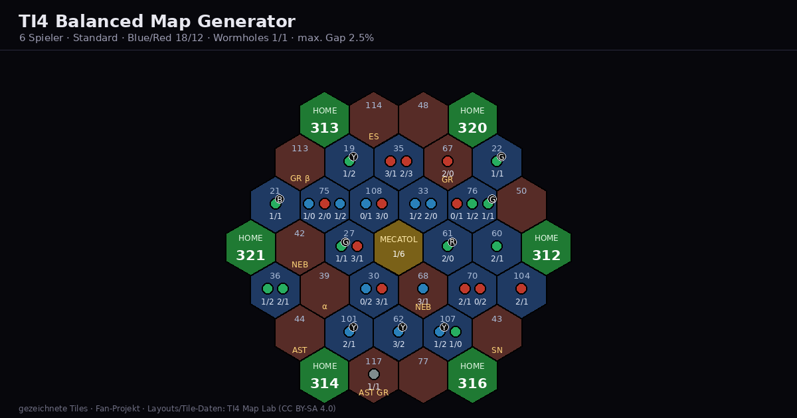

# TI4 Balanced Map Generator

Eine kleine, rein clientseitige Web-App, die **ausgeglichene Twilight-Imperium-4-Karten für 3–6 Spieler** erzeugt
und den passenden **Map-String** sowie eine gerenderte Übersicht ausgibt.

**Live:** https://barcibarci.github.io/ti4-map-generator/

Basiert auf den Layouts und Tile-Daten des [TI4 Map Lab](https://github.com/joepinion/ti4-map-lab) (CC BY-SA 4.0).



## Features

- Spielerzahlen **3–6**, jeweils mit mehreren Layouts (Standard / Skinny / Settlers / Warp / Large Galaxy).
- Tile-Vorrat wählbar: **Grundspiel / Prophecy of Kings / Thunder's Edge**.
- **Vollautomatische Optimierung über alle fünf Bewertungen** (Simple Slice, Joebrew, **Resource Access**,
  **Influence Access**, **Tech Access**) – nicht nur ein einzelner Wert. So werden Einseitigkeiten vermieden
  (z. B. „Ressourcen fair, aber Influence schief“).
- **Automatisches Neugenerieren:** Es laufen mehrere Runden; pro Runde wird der Tile-Vorrat frisch gezogen und die
  Karte komplett optimiert. Ist nach einer Runde noch etwas einseitig, wird neu generiert. Abgebrochen wird, sobald
  keine Bewertung mehr über der Zielschwelle liegt.
- **Evaluator-Umschalter** (Anzeige/Details) und Button **„Balance verbessern“** zum Nachoptimieren einer Karte.
- Ziel-**Blau-Anteil** einstellbar (Standard 60 % ≈ Community-Verhältnis 3:2).
- **Wormholes immer paarweise:** Es sind gleich viele α wie β vorhanden, sofern die Option aktiv ist (mindestens ein
  vollständiges Paar). Da der Optimierer nur gleichfarbige Tiles mit gleichem Wormhole-Typ tauscht, bleibt das Paar
  garantiert erhalten.
- Legalität wird erzwungen: keine zwei Anomalien benachbart, keine zwei gleichen Wormholes benachbart.
- Ausgabe: gerenderte Karte (**PNG**- oder SVG-Download), **Map-String** (kompatibel mit TI4 Map Lab / TTS / keeganw),
  Statistik (Blue/Red, Resources/Influence, Tech, Traits R/G/B, Wormholes) und die Home-Werte.

## Was in der Anzeige bedeutet

| Anzeige | Bedeutung |
| --- | --- |
| `Blue/Red` | Anzahl blauer (besiedelbarer) vs. roter Systeme (leer/Anomalie) im gewählten Set. |
| `Res/Inf` | Summe **Ressourcen** und **Influence** aller Planeten auf der Karte. |
| `Tech` | Vorkommende Tech-Spezialisierungen als Buchstaben: **R**=Warfare, **B**=Propulsion, **G**=Biotic, **Y**=Cybernetic. |
| `Traits R/G/B` | Anzahl roter / grüner / blauer Planeten (Hazardous / Industrial / Cultural). |
| `Wormholes α/β` | Anzahl Alpha- und Beta-Wormholes. |
| `Gap <Evaluator>` | **Gap** = größter minus kleinster Home-Wert unter allen Spielern (in Einheiten des Evaluators). |
| `Max Gap` | größter **relativer** Gap über alle Evaluatoren in % (siehe unten). |
| `Einseitig` | Evaluatoren, deren relativer Gap über der Zielschwelle (2 %) liegt – „hier ist es noch schief“. |

## Lokal starten

Da alles statisch ist, reicht ein einfacher Webserver (nötig, weil `data.js` per `<script>` geladen wird – das geht
auch per Doppelklick, aber ein Server ist sauberer):

```bash
python3 -m http.server 8000
# dann http://localhost:8000/ öffnen
```

## Auf GitHub Pages veröffentlichen

1. Auf GitHub ein neues, leeres Repository anlegen (z. B. `ti4-map-generator`).
2. In diesem Ordner:

```bash
git init
git add .
git commit -m "TI4 balanced map generator"
git branch -M main
git remote add origin https://github.com/<DEIN-NAME>/ti4-map-generator.git
git push -u origin main
```

3. Im Repo: **Settings → Pages → Source: Deploy from a branch → Branch: `main` / `/ (root)`** → Save.
4. Nach ca. 1 Minute erreichbar unter `https://<DEIN-NAME>.github.io/ti4-map-generator/`.
   (Bei einem Repo namens `<DEIN-NAME>.github.io` stattdessen direkt unter der Wurzel.)

## Wie die Optimierung funktioniert

- **Wert pro System**: Summe über die Planeten von `Ressourcen-/Influence-Anteil + Tech-Bonus` gemäß Evaluator,
  plus Boni für Legendary-Planeten etc. (Parameter wie im Map Lab).
- **Home-Wert**: für jedes Heimatsystem die Summe `Systemwert × Distanzgewicht` über alle Systeme in Reichweite.
  Mecatol Rex zählt mit.
- **Gap** = größter − kleinster Home-Wert. Damit die Evaluatoren (mit sehr unterschiedlichen Einheiten) vergleichbar
  sind, wird ein **relativer Gap** = `Gap / größter Betrag` verwendet. Eine **Totzone von 1 Einheit** sorgt dafür,
  dass ein Unterschied von 1 (z. B. ein einzelner Tech-Punkt) nicht übergewichtet wird.
- **Zielfunktion**: minimiert wird `Summe(relative Gaps) + 8 × größter relativer Gap` – der schlechteste Evaluator
  zählt also am stärksten (Mini-Max).
- **Ablauf** beim Klick auf „Karte generieren“ (alles automatisch, kein Zutun nötig):
  1. Tile-Vorrat wählen (Blau/Rot-Ziel, Wormholes paarweise).
  2. Pro Runde: neue Zufallskarte → Warmup auf Simple Slice/Joebrew → Optimierung über **alle fünf** Evaluatoren
     → Bank-Tausche; zwischendurch „Kicks“ (Iterated Local Search). Bei Stillstand wird die Zufallskarte intern neu
     gewürfelt.
  3. Reicht das Ergebnis (noch) nicht, startet eine **neue Runde mit frischem Tile-Vorrat**.
  4. Behalten wird die Karte mit dem kleinsten kombinierten Gap; Gesamt-Zeitbudget je Wahl ≈ 4–10 s. Abgebrochen wird
     früh, sobald der größte relative Gap ≤ 2 % ist.
- Typische Ergebnisse: **3–4 Spieler** meist ≤ 2 %, **5–6 Spieler** meist ≤ 3–5 % (der erreichte Wert wird immer
  angezeigt – die App beschönigt nichts).
- **„Balance verbessern“** optimiert die bestehende Karte weiter (Swaps + Bank-Tausche über alle fünf Evaluatoren).

## Daten aktualisieren

`data.js` wird aus dem Map-Lab-Repo erzeugt:

```bash
python3 build_data.py
```

## Test & Benchmark

```bash
# Vollständige Prüfung aller Layouts: Gaps, legale Platzierung, Wormhole-Paare, keine Tile-Dubletten
node test.js 4000        # optional: Zeitbudget in ms pro Karte

# Benchmark der App-Pipeline (generateRounds) über alle Layouts
node tools/measure.js
```

## Screenshot / Beispielkarte neu erzeugen

```bash
node tools/export_map.js        # schreibt tools/map.json (Beispielkarte)
python3 tools/make_screenshot.py # rendert screenshot.png (1200x630, Pillow)
```

## Credits & Lizenz

> **Nicht-kommerzielles Fan-Projekt.** Twilight Imperium ist ein Markenzeichen von Fantasy Flight Games / Asmodee;
> dieses Projekt steht in keiner Verbindung dazu.

- **Layouts, Tile-Daten und die Evaluator-Vorlagen stammen aus dem
  [TI4 Map Lab](https://github.com/joepinion/ti4-map-lab) von Joseph Arthur Ellis** und werden von `build_data.py`
  automatisch von dort geladen. Diese Daten stehen unter **CC BY-SA 4.0** – die Namensnennung ist deshalb Pflicht und
  im UI-Footer sowie hier angegeben.
- Eigener Code (Generator, Optimierer, Rendering, UI): frei verwendbar (z. B. MIT).
- Beim Weiterverbreiten die **CC-BY-SA-Auflagen** der Kartendaten beachten (Namensnennung + Share-Alike).
